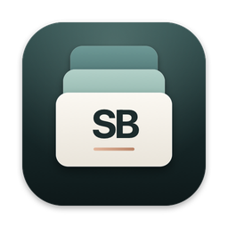
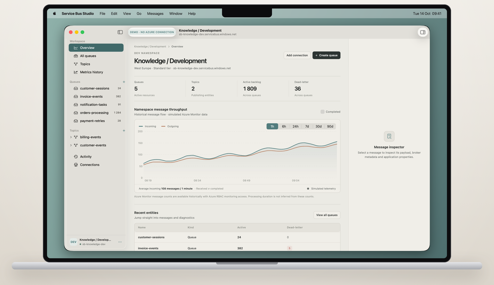
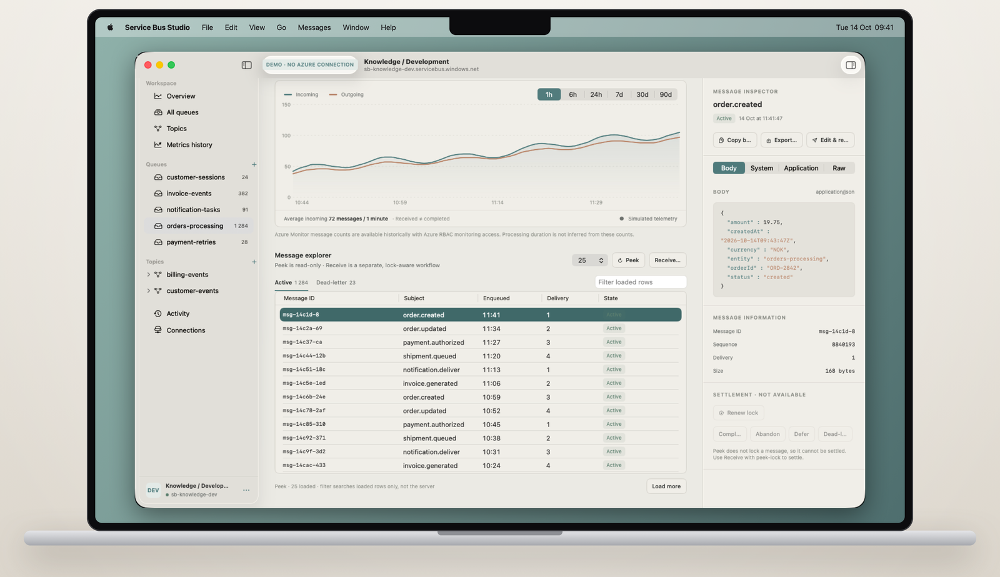
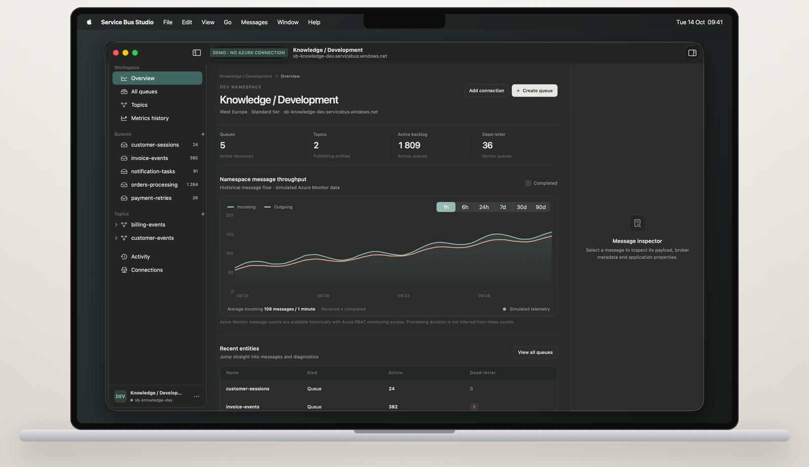

<p align="center">
  
</p>

<h1 align="center">Service Bus Studio</h1>

<p align="center">A calm, native Mac app for Azure Service Bus.<br>Browse queues, topics and subscriptions, inspect messages safely, and fix dead letters without leaving your Mac.</p>

<p align="center">
  
</p>

## What it does

- **Browse everything:** queues, topics and subscriptions with active, dead-letter and scheduled counts.
- **Peek safely:** peeking never locks or removes a message. Inspect the JSON body, broker metadata and application properties.
- **Receive on purpose:** peek-lock with a live lock countdown, then complete, abandon, defer or dead-letter. Receive-and-delete is a separate, clearly marked mode.
- **Repair dead letters:** see why a message failed, edit it and resend it as a new message.
- **Manage entities:** create, edit and delete queues, topics and subscriptions. Deleting asks you to type the exact name.
- **Sessions, scheduled and deferred messages**, a command palette (⌘K), and warm light and dark themes.

<p align="center">
  
</p>

## Install

### With Homebrew (recommended)

```sh
brew install --cask sandyprc/tap/service-bus-studio
```

This adds the tap and installs **Service Bus Studio** into your Applications folder.

### Or download it

1. Open the [latest release](https://github.com/Sandyprc/sbs/releases/latest).
2. Download `ServiceBusStudio-<version>.dmg`.
3. Open the DMG and drag **Service Bus Studio** into **Applications**.

### First launch

Installed with Homebrew? It opens straight away.

Downloaded the DMG? Service Bus Studio is not notarized by Apple yet, so macOS blocks the first launch:

1. Open **Service Bus Studio** from Applications. When macOS says it cannot verify the app, click **Done**.
2. Run this to jump straight to the right settings page, then click **Open Anyway** and confirm:

   ```sh
   open "x-apple.systempreferences:com.apple.settings.PrivacySecurity.extension"
   ```

Or skip both steps by clearing the download flag:

```sh
xattr -dr com.apple.quarantine "/Applications/Service Bus Studio.app"
```

## Update

From version 0.1.1 the app updates itself. It checks once a day and asks before installing; you can also choose **Service Bus Studio › Check for Updates…** at any time, or turn automatic checks off in Settings.

On 0.1.0, update once by hand:

```sh
brew upgrade --cask service-bus-studio
```

If you installed from the DMG, download the new release and replace the app in Applications.

## Uninstall

```sh
brew uninstall --cask service-bus-studio
```

To also remove its settings and saved connection list: `brew uninstall --zap --cask service-bus-studio`. Saved connection strings live in your login Keychain under **com.sandyprc.servicebusstudio.connection**; delete them in Keychain Access if you no longer need them.

## Getting started

- **Try it offline:** choose **Explore sample namespace** on the welcome screen. Everything works on demo data and nothing is sent anywhere.
- **Connect with a connection string:** choose **Add a connection**, pick **SAS connection string** and paste it. It is stored only in your Keychain.
- **Local emulator:** the [Azure Service Bus emulator](https://learn.microsoft.com/azure/service-bus-messaging/overview-emulator) works too; add its connection string (with `UseDevelopmentEmulator=true`) as a connection.
- **Microsoft Entra ID:** sign-in uses your own app registration (a public client with redirect URI `servicebusstudio://auth`). Entra ID is also what unlocks Azure Monitor metrics history. This option is new and still being verified.

## Requirements

- macOS 15 Sequoia or later
- A Mac with Apple silicon

## Privacy

- No telemetry and no accounts.
- Connection strings and sign-in tokens are kept in the macOS Keychain, never in files.
- Message bodies are only saved when you export one.

## Feedback

Found a bug or want a feature? [Open an issue](https://github.com/Sandyprc/sbs/issues).

This repository hosts the downloads. The Homebrew cask lives in [Sandyprc/homebrew-tap](https://github.com/Sandyprc/homebrew-tap). The app's source code is not public.

<p align="center">
  
</p>
